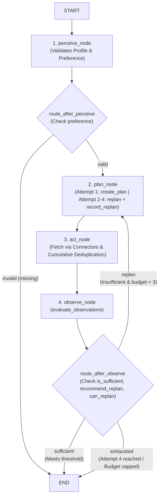

# InternIQ Task Notes: LangGraph Search–Observe–Replan Orchestration

**Author:** Samriddhi Raj
**Role:** Agent Core & Interface Engineer (Team HumanBot)
**Date:** November 2026
**Status:** Milestone 3, Work Item 1 Completed, Tested (`21/21 PASSED`), Full Suite Clean (`117/117 PASSED`)

---

## 1. Overview & Architecture Role

The **LangGraph Orchestrator** (`agent/graph.py`) coordinates the bounded discovery and application lifecycle across InternIQ.

Milestone 3, Work Item 1 implements the **Search-Observe-Replan discovery loop portion** of the agentic pipeline:

$$\text{START} \longrightarrow \mathbf{\text{Perceive}} \xrightarrow{\text{valid}} \mathbf{\text{Plan (1)}} \longrightarrow \mathbf{\text{Act}} \longrightarrow \mathbf{\text{Observe}} \xrightarrow{\text{insufficient}} \mathbf{\text{Plan (2, 3, 4)}} \xrightarrow{\text{sufficient / capped}} \text{END}$$

> [!NOTE]
> Only the Search-Observe-Replan discovery loop (Nodes 1 through 4) is implemented in Work Item 1. Downstream pipeline stages (Node 5: Vet, Node 6: Rank, Node 7: Generate, Node 8: Approve, and Node 9: Record) will be integrated in Milestone 3 Work Items 2 through 4.

The search loop implements the formal contract between:
1. **Candidate Profile & Preference State:** Verified candidate goals and constraint boundaries.
2. **SearchPlanner Engine (`agent/planner.py`):** Formulates initial plans, diagnoses observation sufficiency, and generates progressively broadened search criteria. Supports both `SearchPlan` model instances and dictionaries.
3. **ExecutionBudget Circuit Breaker (`agent/limits.py`):** Authoritatively caps execution at a maximum of 3 re-planning rounds (4 total search attempts).
4. **Data Ingestion Connectors (`tools/fetchers/`):** Executes queries across authorized job boards (Greenhouse, Lever) and manual CSV feeds with cumulative deduplication and accurate tool-call accounting.

---

## 2. Implemented Components (Work Item 1)

### A. Typed State Schema (`InternIQAgentState`)
Built on Pydantic V2 and fully supported by LangGraph's `StateGraph`:

```python
class InternIQAgentState(BaseModel):
    run_id: str
    created_at: datetime = Field(default_factory=datetime.utcnow)
    profile: Optional[Profile] = None
    preference: Optional[Preference] = None
    budget: ExecutionBudget = Field(default_factory=ExecutionBudget)

    # Discovery & Listings
    listings: List[Listing] = Field(default_factory=list)
    source_status: Dict[str, str] = Field(default_factory=dict)

    # Work Item 1: Search Plan & Observation Evaluation Tracking
    current_plan: Optional[Union[SearchPlan, Dict[str, Any]]] = None
    evaluation: Optional[ObservationEvaluation] = None
    iteration: int = 1
    csv_content: Optional[str] = None
    source_config: Dict[str, Any] = Field(default_factory=dict)

    # Downstream Nodes (Milestone 3 Work Items 2-4)
    eligibility_map: Dict[str, EligibilityResult] = Field(default_factory=dict)
    risk_map: Dict[str, List[RiskFlag]] = Field(default_factory=dict)
    scores_map: Dict[str, ScoreBreakdown] = Field(default_factory=dict)
    ranked_listing_ids: List[str] = Field(default_factory=list)
    drafts_map: Dict[str, ApplicationDraft] = Field(default_factory=dict)
    approval: Optional[Approval] = None
    errors: List[str] = Field(default_factory=list)
    completion_status: str = "in_progress"
```

### B. Functional State Updates
All nodes return dictionaries representing state updates rather than mutating shared state objects or mutable collections in place. This guarantees deterministic state transitions, auditability, and replayability.

### C. Node Definitions & Responsibilities

1. **`perceive_node` & `route_after_perceive`:**
   - Validates candidate preference and profile.
   - If preference is missing, sets `completion_status = "failed_validation"` and records the validation error.
   - `route_after_perceive` inspects the state:
     - **Valid:** Routes forward to `plan_node`.
     - **Invalid (Missing Preference):** Routes directly to `END`, bypassing planning and fetching completely.

2. **`plan_node`:**
   - **Initial Search (Attempt 1):** Invokes `planner.create_plan(preference, attempt=1, profile=profile)`. Budget replan counter is preserved at 0.
   - **Progressive Re-planning (Attempts 2, 3, 4):** Invokes `planner.replan(current_plan, evaluation, preference, profile=profile)`.
   - **Dual Model/Dict Support:** Uses `_get_plan_field()` to read fields whether `current_plan` is an instantiated `SearchPlan` or a dictionary.
   - **Circuit Breaker Integration:** If `new_plan` is generated, calls `new_budget.record_replan()` **exactly once**. If replanning fails or cannot relax, `record_replan()` is never called.

3. **`act_node`:**
   - Reads `target_sources` from the active search plan.
   - Supports manual CSV ingestion from in-memory `state.csv_content` or `preference.constraints.get("csv_content")`. Does not read arbitrary filesystem paths.
   - Reads employer tokens/sites safely from `state.source_config` or preference constraints without inventing company identifiers.
   - Safely records unconfigured sources (`"unconfigured: missing board token"`) without executing tool calls.
   - **Tool-Call Accounting:** Calls `new_budget.record_tool_call()` for every attempted fetch. Even if an external fetch raises an exception, the attempted call is counted in the budget.
   - **Cumulative Deduplication:** Combines previous listings with newly fetched listings and deduplicates them using `normalize_dedupe()`, guaranteeing that repeated search iterations never duplicate records.

4. **`observe_node`:**
   - Invokes `planner.evaluate_observations(listings, preference, profile, attempt=iteration)`.
   - Produces structured `ObservationEvaluation` with itemized failure reasons and diagnosis.

5. **`route_after_observe` (Conditional Routing):**
   - Returns `"sufficient"` $\longrightarrow$ routes to `END` when opportunities satisfy candidate goals.
   - Returns `"replan"` $\longrightarrow$ routes back to `plan_node` when observations are insufficient, replan is recommended, and `budget.can_replan()` is True.
   - Returns `"exhausted"` $\longrightarrow$ routes to `END` when Attempt 4 has finished or budget is capped.

---

## 3. Workflow Architecture



---

## 4. Execution Budget & Re-planning Bounds

| Iteration | Attempt Stage | Budget Counter (`current_replan_count`) | `can_replan()` | `route_after_observe` Result |
| :---: | :--- | :---: | :---: | :---: |
| **Attempt 1** | Initial Search Plan | `0` | `True` | `"replan"` (if insufficient) |
| **Attempt 2** | Replan 1 (Location Relaxation) | `1` | `True` | `"replan"` (if insufficient) |
| **Attempt 3** | Replan 2 (Domain Relaxation) | `2` | `True` | `"replan"` (if insufficient) |
| **Attempt 4** | Replan 3 (Stipend / Query Expansion) | `3` (Cap Reached) | `False` | **`"exhausted"` $\longrightarrow$ END** |
| **Attempt 5** | Physically Impossible | — | — | **Blocked** |

---

## 5. Usage Example

```python
from agent.graph import build_search_loop_graph
from tools.schemas import Preference, Profile, WorkMode

app = build_search_loop_graph()

pref = Preference(
    profile_id="p1",
    target_roles=["Machine Learning Intern"],
    domains=["FinTech"],
    locations=["Bangalore"],
    work_modes=[WorkMode.REMOTE],
    min_stipend=30000.0,
)

initial_state = {
    "run_id": "run_demo_01",
    "preference": pref,
    "csv_content": (
        "title,organization,description,locations,work_mode,stipend\n"
        "Machine Learning Intern,Nova Labs,Build LLM systems,Bangalore,remote,35000\n"
        "Machine Learning Intern,FinAI Corp,Predictive modeling,Bangalore,remote,32000\n"
        "Machine Learning Intern,QuantTech,FinTech NLP pipelines,Bangalore,remote,38000\n"
    ),
}

result = app.invoke(initial_state)

print(result["iteration"])                    # 1 (sufficient on initial run)
print(result["budget"].current_replan_count)  # 0
print(result["evaluation"].is_sufficient)     # True
print(len(result["listings"]))                # 3
```

---

## 6. Verification Evidence

### Graph Unit Tests (`tests/unit/test_graph.py`):
```bash
.venv/bin/pytest tests/unit/test_graph.py -v
```

```text
============================= test session starts ==============================
collected 21 items

tests/unit/test_graph.py::test_graph_state_model_defaults PASSED         [  4%]
tests/unit/test_graph.py::test_perceive_node_valid PASSED                [  9%]
tests/unit/test_graph.py::test_perceive_node_missing_preference PASSED   [ 14%]
tests/unit/test_graph.py::test_route_after_perceive PASSED               [ 19%]
tests/unit/test_graph.py::test_compiled_graph_missing_preference_terminates_immediately PASSED [ 23%]
tests/unit/test_graph.py::test_plan_node_initial_attempt_1 PASSED        [ 28%]
tests/unit/test_graph.py::test_plan_node_replan_increments_budget_once PASSED [ 33%]
tests/unit/test_graph.py::test_plan_node_with_search_plan_model_instance PASSED [ 38%]
tests/unit/test_graph.py::test_plan_node_budget_exhausted_blocks_replan PASSED [ 42%]
tests/unit/test_graph.py::test_act_node_with_manual_csv PASSED           [ 47%]
tests/unit/test_graph.py::test_act_node_with_search_plan_model_instance PASSED [ 52%]
tests/unit/test_graph.py::test_act_node_unconfigured_source_safety PASSED [ 57%]
tests/unit/test_graph.py::test_act_node_cumulative_deduplication PASSED  [ 61%]
tests/unit/test_graph.py::test_act_node_source_failure_handled_gracefully PASSED [ 66%]
tests/unit/test_graph.py::test_observe_node_evaluates_observations PASSED [ 71%]
tests/unit/test_graph.py::test_route_after_observe_sufficient PASSED     [ 76%]
tests/unit/test_graph.py::test_route_after_observe_replan PASSED         [ 80%]
tests/unit/test_graph.py::test_route_after_observe_budget_exhausted PASSED [ 85%]
tests/unit/test_graph.py::test_compiled_graph_sufficient_results_no_replan PASSED [ 90%]
tests/unit/test_graph.py::test_compiled_graph_insufficient_results_exact_three_replans_cap PASSED [ 95%]
tests/unit/test_graph.py::test_compiled_graph_attempt_5_impossible PASSED [100%]

======================= 21 passed, 84 warnings in 0.19s ========================
VERDICT: PASS
```

### Full Project Test Suite (117 Tests, Zero Regressions):
```bash
.venv/bin/pytest tests/ -v
# Result: 117 passed, 230 warnings in 0.95s
```
