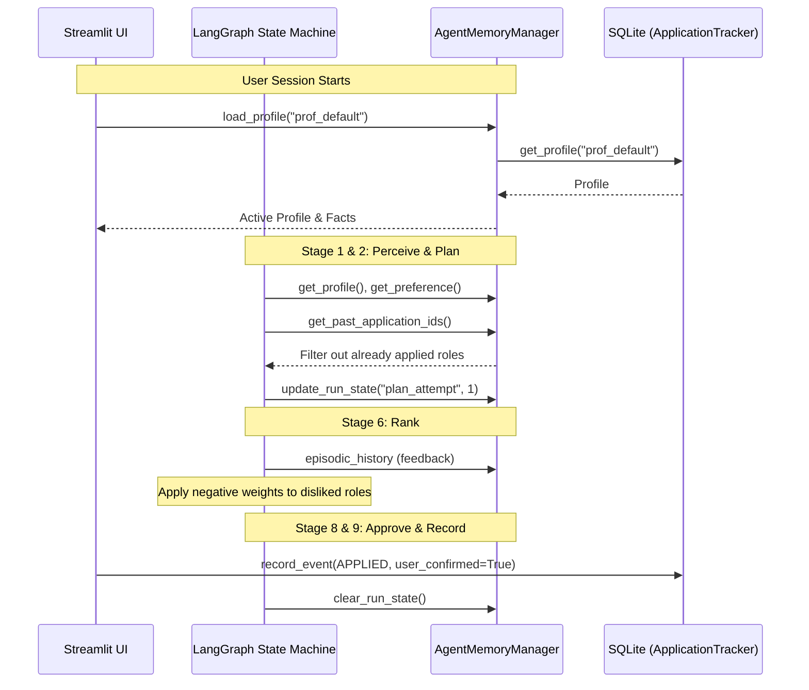

# InternIQ: Three-Layer Agent Memory Architecture & Persistence Notes

**Author:** Samriddhi Raj
**Role:** Agent Core & Interface Engineer (Team HumanBot)
**Date:** November 2026
**Status:** Implemented, Tested (`10/10 PASSED`), Cleanly Integrated

---

## 1. Overview of the Three-Layer Agent Memory Architecture

The memory subsystem of InternIQ implements the **Three-Layer Agent Memory Architecture** specified in Section 7.1 and Table 6 of the InternIQ Technical Report.

Unlike stateless language models or naive single-session scripts, InternIQ requires distinct memory tiers to balance fast runtime execution, cross-session continuity, and contextual decision-making:

```
+-----------------------------------------------------------------------------------------+
|                               AgentMemoryManager (agent/memory.py)                      |
+-----------------------------------------------------------------------------------------+
|                                                                                         |
|  [Layer 1: Profile Memory]                                                              |
|   - Student background: education, verified skills, projects, and atomic EvidenceFacts   |
|   - Backed by SQLite 'profiles' table via ApplicationTracker                            |
|   - Fast in-memory cache for agent reasoning; persistent across restarts                |
|                                                                                         |
|  [Layer 2: Episodic Memory]                                                             |
|   - Past student interactions, ranking feedback ('good_match', 'irrelevant')            |
|   - Recorded application lifecycle history ('applied' events)                           |
|   - Prevents redundant recommendations; guides re-planning and ranking adjustments      |
|                                                                                         |
|  [Layer 3: Run Working State (Scratchpad)]                                              |
|   - Ephemeral key-value scratchpad for the active LangGraph execution loop              |
|   - Holds current plan attempt count, temporary listing IDs, search query variations    |
|   - Reset via clear_run_state() upon loop termination                                   |
|                                                                                         |
+-----------------------------------------------------------------------------------------+
                                          |
                                          v  (Dependency Injection)
                       +--------------------------------------+
                       |  ApplicationTracker (tools/tracker.py) |
                       +--------------------------------------+
                                          |
                                          v
                       +--------------------------------------+
                       |       interniq.db (SQLite Storage)   |
                       +--------------------------------------+
```

---

## 2. API Breakdown by Memory Layer

The memory manager is encapsulated within `AgentMemoryManager` in `agent/memory.py`.

### Layer 1: Profile Memory
Stores verified candidate attributes with provenance (supporting zero-hallucination verification).

* `set_profile(profile: Profile, persist: bool = True) -> None`
  Sets the active profile in RAM (`self.profile_memory`). When `persist=True` (default), it immediately calls `self.tracker.save_profile(profile)` to write the record to SQLite. Enforces strict type validation (`TypeError` if not a `Profile`).
* `get_profile() -> Optional[Profile]`
  Retrieves the active profile currently loaded in working memory.
* `load_profile(profile_id: str) -> Optional[Profile]`
  Fetches the candidate record from SQLite via `self.tracker.get_profile(profile_id)`, updates the in-memory cache `self.profile_memory`, and returns the rehydrated `Profile` model (or `None` if not found).
* `set_preference(preference: Preference) -> None`
  Stores the student's active role, domain, location, and stipend preferences in `self.preference_memory`.
* `get_preference() -> Optional[Preference]`
  Retrieves the active candidate preference from working memory.

### Layer 2: Episodic Memory
Maintains historical context across search sessions and candidate feedback loops.

* `record_feedback(opportunity_id: str, label: str, reason: Optional[str] = None) -> str`
  Records candidate evaluation feedback (e.g., `good_match`, `irrelevant`, `too_senior`) in the SQLite `feedback` table and appends a structured record to `self.episodic_history`. Returns the generated `feedback_id`.
* `get_past_application_ids() -> List[str]`
  Queries `self.tracker.get_events()`, filters records where `event_type == "applied"`, and returns a deduplicated list of opportunity IDs. The search planner uses this list to avoid recommending roles the student has already applied to.
* `record_episode(episode: Dict[str, Any]) -> None`
  Preserves backward compatibility. Appends arbitrary intermediate execution summaries, search observation metrics, or loop summaries to `self.episodic_history`.

### Layer 3: Run Working State (Scratchpad)
Short-lived temporary state during a single LangGraph execution run.

* `update_run_state(key: str, value: Any) -> None`
  Stores intermediate computation results (such as `plan_attempt: 2`, `discovered_ids: [...]`, or `last_search_query`) in `self.run_scratchpad`. Validates that `key` is a non-empty string.
* `get_run_state(key: str, default: Any = None) -> Any`
  Safely retrieves a scratchpad value with a fallback default.
* `clear_run_state() -> None`
  Wipes all temporary variables from `self.run_scratchpad` when an execution cycle concludes.

---

## 3. SQLite Integration & Dependency Injection

`AgentMemoryManager` coordinates persistence through Sadiqua Parween's `ApplicationTracker` (`tools/tracker.py`) without modifying any of her code.

### Dependency Injection Pattern
The class constructor allows injecting an existing `ApplicationTracker` instance or specifying an alternate SQLite database file path:

```python
class AgentMemoryManager:
    def __init__(
        self,
        db_path: str = "interniq.db",
        tracker: Optional[ApplicationTracker] = None,
    ):
        self.tracker: ApplicationTracker = (
            tracker if tracker is not None else ApplicationTracker(db_path=db_path)
        )
        self.profile_memory: Optional[Profile] = None
        self.preference_memory: Optional[Preference] = None
        self.episodic_history: List[Dict[str, Any]] = []
        self.run_scratchpad: Dict[str, Any] = {}
```

### Reused Tracker Methods
The memory module reuses the following pre-tested methods from `ApplicationTracker`:
* `save_profile(profile: Profile) -> bool`
* `get_profile(profile_id: str) -> Optional[Profile]`
* `save_feedback(opportunity_id: str, label: str, reason: Optional[str] = None) -> str`
* `get_events(opportunity_id: Optional[str] = None) -> List[Dict[str, Any]]`
* `delete_all_user_data() -> int`

---

## 4. Privacy and Data Deletion (`purge_all_data`)

The `purge_all_data()` method implements local data wiping:

```python
def purge_all_data(self) -> int:
    self.profile_memory = None
    self.preference_memory = None
    self.episodic_history.clear()
    self.run_scratchpad.clear()
    return self.tracker.delete_all_user_data()
```

### Important Behavioral Clarifications:
1. **Deletes ALL Records in the Database:**
   `purge_all_data()` delegates directly to `ApplicationTracker.delete_all_user_data()`. In `tools/tracker.py`, this function runs unqualified SQL delete statements:
   ```sql
   DELETE FROM tracker_events;
   DELETE FROM profiles;
   DELETE FROM opportunities;
   DELETE FROM drafts;
   DELETE FROM feedback;
   DELETE FROM audit_log;
   ```
   It does **not** filter by a single profile (`WHERE profile_id = ?`). It operates as a complete local database reset. In a multi-profile database, calling this will delete records belonging to all profiles in that SQLite file.
2. **Regulatory Scope:**
   InternIQ is designed as a local-first desktop assistant storing data in the user's local directory. While `purge_all_data()` provides an effective local device wipe supporting user data erasure requests, **this method alone does not constitute or guarantee complete DPDP Act or GDPR compliance**. Comprehensive regulatory compliance requires organizational safeguards, secure key handling, system-level file deletion assurances, and auditable data lifecycle management beyond a single application method.

---

## 5. Practical Usage Examples

### Example A: Initializing and Persisting Profile Memory
```python
from agent.memory import AgentMemoryManager
from tools.schemas import Profile, Education, Preference, WorkMode

# Initialize memory manager with custom database
memory = AgentMemoryManager(db_path="interniq.db")

# Save a profile into memory and SQLite
profile = Profile(
    profile_id="prof_001",
    full_name="Samriddhi Raj",
    email="samriddhi@example.edu",
    education=[
        Education(
            degree="B.Tech Computer Science",
            institution="S-VYASA University",
            graduation_year=2026,
            cgpa=9.1,
        )
    ],
    skills=["Python", "LangGraph", "Streamlit"],
)

memory.set_profile(profile, persist=True)

# Set search preference
pref = Preference(
    profile_id="prof_001",
    target_roles=["AI Engineer Intern"],
    locations=["Bangalore", "Remote"],
    work_modes=[WorkMode.REMOTE],
)
memory.set_preference(pref)
```

### Example B: Using Episodic Memory to Avoid Redundant Recommendations
```python
# Check previously applied opportunities
applied_ids = memory.get_past_application_ids()
print(f"Already applied to: {applied_ids}")

# Filter out applied roles from newly fetched opportunities
unapplied_listings = [
    listing for listing in candidate_listings
    if listing.listing_id not in applied_ids
]

# Record student feedback on a specific match
fb_id = memory.record_feedback(
    opportunity_id="opp_101",
    label="irrelevant",
    reason="Requires 3+ years experience, mismatch for intern",
)
```

### Example C: Using Run Scratchpad During Agent Search Loop
```python
# Track search loop state
memory.update_run_state("plan_attempt", 1)
memory.update_run_state("current_query", "machine learning intern remote")

# Retrieve values with defaults
attempt = memory.get_run_state("plan_attempt", default=1)
if attempt < 3:
    memory.update_run_state("plan_attempt", attempt + 1)

# Cleanup after workflow completes
memory.clear_run_state()
```

### Example D: Performing a Device-Level Data Wipe
```python
# Full local wipe
deleted_event_count = memory.purge_all_data()
print(f"Purged {deleted_event_count} tracker events and wiped local database.")
assert memory.get_profile() is None
assert memory.get_preference() is None
```

---

## 6. Integration with LangGraph Workflow

The memory subsystem is designed to interface directly with the LangGraph state machine (`agent/graph.py`):



1. **`perceive` Node:** Initializes `InternIQAgentState` by retrieving `profile` and `preference` from `AgentMemoryManager`.
2. **`plan` Node:** Calls `memory.get_past_application_ids()` to exclude already-applied opportunities from search queries.
3. **`observe` / Re-planning:** Tracks `plan_attempt` in `run_scratchpad` to evaluate if progressive query relaxation is needed (up to 3 rounds).
4. **`rank` Node:** Reads negative feedback signals from `memory.episodic_history` to penalize companies or job types the student marked as irrelevant.
5. **`record` Node:** Confirmed applications update the tracker; `memory.clear_run_state()` resets intermediate variables for the next run.

---

## 7. Verification Evidence

The module was verified using unit tests authored in `tests/unit/test_memory.py`:

```bash
.venv/bin/pytest tests/unit/test_memory.py -v
```

### Test Output:
```text
tests/unit/test_memory.py::test_memory_initialization_defaults_and_injection PASSED [ 10%]
tests/unit/test_memory.py::test_profile_memory_set_get_and_persistence PASSED [ 20%]
tests/unit/test_memory.py::test_profile_memory_load_from_sqlite PASSED   [ 30%]
tests/unit/test_memory.py::test_profile_memory_type_validation PASSED    [ 40%]
tests/unit/test_preference_memory_set_and_get PASSED     [ 50%]
tests/unit/test_episodic_memory_record_feedback PASSED   [ 60%]
tests/unit/test_episodic_memory_get_past_application_ids PASSED [ 70%]
tests/unit/test_episodic_memory_record_episode PASSED    [ 80%]
tests/unit/test_run_working_state_scratchpad PASSED      [ 90%]
tests/unit/test_privacy_purge_all_data PASSED            [100%]

======================= 10 passed, 13 warnings in 0.08s ========================
VERDICT: PASS
```

All 29 tests across memory, tracker, scam detection, and eligibility continue to pass with zero regressions.
