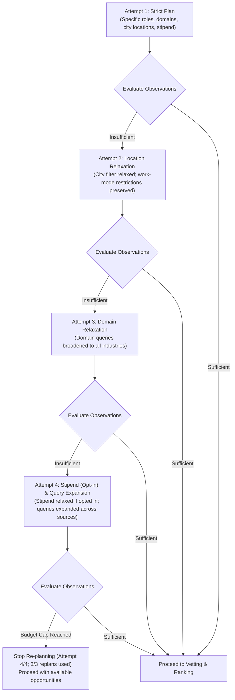

# InternIQ Task Notes: Multi-Source Search Planner & Dynamic Query Formulator

**Author:** Samriddhi Raj
**Role:** Agent Core & Interface Engineer (Team HumanBot)
**Date:** November 2026
**Status:** Work Items 1, 2, and 3 Completed, Tested (`36/36 PASSED`), Full Suite Clean (`87/87 PASSED`)

---

## 1. Overview & Architecture Role

The **Multi-Source Search Planner** (`agent/planner.py`) owns the planning, observation evaluation, and progressive re-planning stages of the InternIQ agentic loop:

$$\text{Perceive} \longrightarrow \mathbf{\text{Plan (1)}} \longrightarrow \text{Act} \longrightarrow \mathbf{\text{Observe (Evaluate)}} \longrightarrow \mathbf{\text{Re-plan (2, 3)}} \longrightarrow \text{Vet} \longrightarrow \text{Rank} \dots$$

The planner operates in three complementary phases across the discovery cycle:
1. **Initial Planning (`create_plan`):** Formulates structured initial search plans (`SearchPlan`) and dynamic query tiers grounded in candidate verified profile data and target preferences.
2. **Observation Evaluation (`evaluate_observations`):** Evaluates retrieved opportunities across role relevance, domain fit, and location/work-mode compatibility; diagnoses root causes of insufficiency.
3. **Progressive Constraint Relaxation (`replan` / `relax_plan`):** When observations are insufficient, systematically broadens search constraints across bounded iterations (max 3 rounds) without compromising core user requirements.

---

## 2. Work Item 1: Implemented Planning Features

### A. Dynamic Search Query Formulation
Instead of searching for a single static string, the planner constructs three complementary query tiers:
1. **Primary Target Role Queries:** Exact job titles specified by the student (e.g., `"Machine Learning Intern"`).
2. **Domain-Specialized Queries:** Contextual pairings combining preferred domains and roles (e.g., `"FinTech Machine Learning Intern"`), while suppressing redundant repeats (e.g., preventing `"AI AI Engineer Intern"`).
3. **Skill-Focused Queries:** Targeted queries using verified technical skills (e.g., `"PyTorch Intern"`, `"Python Intern"`).

### B. Low-Signal Tool Filtering
Generic utility tools (e.g., `git`, `github`, `linux`, `bash`, `shell`, `docker`, `jira`, `ci/cd`, `rest api`) are filtered out from standalone title generation to prevent unhelpful queries like `"Git Intern"` or `"Linux Intern"`.

### C. Case-Insensitive Deduplication
All query strings and atomic keywords are normalized and deduplicated case-insensitively, preventing duplicate fetcher requests.

### D. Safe Input Validation & Edge Case Handling
* **Empty / Blank Target Roles:** Defaults gracefully to `["Software Engineering Intern"]`.
* **Missing Domains or Locations:** Cleanly handled as empty lists without crashing.
* **Missing or None Profile:** Successfully generates role-based queries and sets empty graduation year filters.
* **Safe Graduation Year Extraction:** Safely inspects candidate education items for integer graduation years.
* **Attempt Clamping:** Bounded strictly between $[1, 4]$ (1 initial search + up to 3 re-planning rounds) per Section 10.6 execution limits and `ExecutionBudget`.

### E. Backward & Forward API Compatibility
The planner supports all existing calling patterns without breaking changes:
* `planner.create_plan(preference)`
* `planner.create_plan(preference, attempt=2)`
* `planner.create_plan(preference, 2)` (positional integer attempt)
* `planner.create_plan(preference, profile=profile)`
* `planner.create_plan(preference, profile)` (positional Profile)
* `planner.create_plan(preference, profile, 2)`
* `planner.create_plan(preference, 2, profile)`
* `planner.create_plan(preference, profile=profile, attempt=2)`

---

## 3. Work Item 2: Observation Evaluation & Insufficiency Diagnosis

### A. Structured Evaluation Model (`ObservationEvaluation`)
Evaluations produce a strongly typed Pydantic model:

```python
class ObservationEvaluation(BaseModel):
    is_sufficient: bool            # True if relevant listings meet min_sufficient_count
    total_observations: int       # Total raw listings retrieved (alias: total_listings)
    relevant_observations: int    # Listings passing role, domain, location checks (alias: relevant_listings)
    reasons: List[str]            # Itemized insufficiency explanations
    diagnosis: str                # Natural-language summary of findings
    recommend_replan: bool        # True if results insufficient AND attempt < 4 (alias: should_replan)
    relevant_listing_ids: List[str] # Listing IDs of qualifying opportunities
    unusable_count: int           # Count of malformed listings missing title/ID
    role_match_count: int         # Listings matching target roles
    domain_match_count: int       # Listings matching preferred domains
    location_match_count: int     # Listings matching preferred locations/work modes
```

### B. Relevance Determination Logic
* **Role Match:** Checks listing title for exact role phrases, non-generic tokens (ignoring `"intern"`, `"junior"`), and standard tech acronyms (`"ml"`, `"ai"`, `"ui"`, `"backend"`).
* **Domain Match:** Inspects `title`, `description[:1500]`, and skills for domain signals (FinTech, Healthcare, EdTech, Cloud, Cybersecurity).
* **Location Match:** Evaluates remote compatibility or physical city matches. Listings with missing location data are not silently treated as matching.
* **Malformed Listings:** Items lacking title or listing ID are tallied under `unusable_count` and disqualified.

---

## 4. Work Item 3: Progressive Constraint Relaxation

### A. Goal & Re-planning Policy
When observation evaluation reports insufficient listings, the agent must not repeat the exact same search query. Instead, `SearchPlanner.replan()` generates a progressively broader `SearchPlan` across a strictly bounded 3-round execution budget (supporting up to 4 total search attempts: Attempt 1 initial search + Attempts 2, 3, and 4 re-planning rounds, aligning directly with `ExecutionBudget.max_replan_rounds = 3`).

### B. Conservative Relaxation Order
The planner follows a staged, transparent relaxation hierarchy:



1. **Attempt 1 $\longrightarrow$ Attempt 2 (Broaden Locations):**
   * If physical city locations were specified (e.g., `["Bangalore"]`), relaxes the strict city filter to allow any location compatible with the student's allowed work modes (`remote`, `hybrid`, `on_site`).
   * Work-mode preferences are strictly preserved.
2. **Attempt 2 $\longrightarrow$ Attempt 3 (Broaden Domains):**
   * If domain was restricted (e.g., `["FinTech"]`), broadens search queries to target roles across all industries.
   * Target roles and work-mode constraints remain strictly preserved.
3. **Attempt 3 $\longrightarrow$ Attempt 4 (Broaden Stipend if Permitted & Expand Query Variations):**
   * If a minimum stipend filter was active AND the candidate explicitly opted in (`flexible_stipend=True` or `allow_unpaid=True`), relaxes stipend to `None` (unconstrained) to discover wider opportunities.
   * Search queries are expanded across all authorized tools and search sources.

### C. Constraint Preservation Rules
* **Minimum Stipend Filter is NEVER Relaxed by Default:** Candidate minimum stipend is a critical requirement. It is strictly preserved unless explicitly opted in via `preference.constraints["flexible_stipend"] is True` or `preference.constraints["allow_unpaid"] is True`. When `constraints` is empty `{}` (default), `min_stipend` remains unmodified across all 4 attempts.
* **Target Roles Are NEVER Relaxed:** A student seeking a `"Machine Learning Intern"` position will never have their role changed to an unrelated discipline (e.g. Sales or Web Development).
* **User Preferences Are NEVER Mutated:** The candidate's `Preference` and `Profile` objects are strictly read-only. Relaxation applies exclusively to search-time filters in the generated `SearchPlan`.
* **Explicit Hard Constraints Are Respected:** If `preference.constraints` flags `"hard_location"`, `"hard_domain"`, or `"hard_stipend"`, those filters are never relaxed.
* **Graduation Years Are Preserved:** Candidate graduation eligibility constraints are never altered.
* **No Identical Duplicate Plans:** If all constraints are marked hard and no safe relaxation is possible, `replan()` returns `None` rather than generating a redundant duplicate plan.
* **Budget Alignment with `ExecutionBudget`:** `ExecutionBudget` sets `max_replan_rounds = 3`. This accommodates Attempt 1 (initial, 0 replans used) $\rightarrow$ Attempt 2 (Replan 1) $\rightarrow$ Attempt 3 (Replan 2) $\rightarrow$ Attempt 4 (Replan 3, final allowed replan). At Attempt 3, evaluation still recommends replanning if results are insufficient (`recommend_replan=True`). At Attempt 4, budget is exhausted (`recommend_replan=False`), and `replan()` returns `None`.

### D. Audit Trail & Flag Semantics
* **`relaxation_notes`:** Every adjustment is explicitly logged with iteration number, old filter value, and new relaxed value.
* **`relaxed_mode`:** Set to `False` on initial plans; set to `True` only when actual constraint relaxation occurs.

### E. Planning Recommendations vs. LangGraph Execution
* `SearchPlanner` is an engine that calculates recommendations, generates search plans, and evaluates observations.
* The LangGraph workflow (`agent/graph.py`) remains the execution orchestrator: it invokes tool fetchers, manages graph state, checks the authoritative `ExecutionBudget` (`budget.can_replan()`), and enforces circuit breakers.

---

## 5. Usage Examples

### Example 1: Progressive Relaxation Across Search Rounds
```python
from agent.planner import SearchPlanner
from tools.schemas import Preference, Profile, Education, WorkMode

planner = SearchPlanner()
# Note: min_stipend is preserved by default; student explicitly permits flexible stipend
pref = Preference(
    profile_id="p1",
    target_roles=["Machine Learning Intern"],
    domains=["FinTech"],
    locations=["Bangalore"],
    work_modes=[WorkMode.REMOTE, WorkMode.HYBRID],
    min_stipend=30000.0,
    constraints={"flexible_stipend": True},
)
prof = Profile(
    profile_id="p1",
    full_name="Samriddhi Raj",
    email="samriddhi@example.edu",
    education=[Education(degree="B.Tech CSE", institution="S-VYASA", graduation_year=2026)],
    skills=["Python", "PyTorch"],
)

# 1. Attempt 1: Strict Plan (Initial Search)
plan_1 = planner.create_plan(pref, prof, attempt=1)
print(plan_1["filters"]["locations"])  # ['Bangalore']
print(plan_1["filters"]["min_stipend"]) # 30000.0
print(plan_1["relaxed_mode"])          # False

# 2. Evaluate Attempt 1 (0 results returned)
eval_1 = planner.evaluate_observations([], pref, prof, attempt=1)
print(eval_1.recommend_replan)         # True

# 3. Attempt 2: Replan 1 (Relax Location)
plan_2 = planner.replan(plan_1, eval_1, pref, prof)
print(plan_2["attempt"])               # 2
print(plan_2["filters"]["locations"])  # [] (open location, matching remote/hybrid)
print(plan_2["relaxed_mode"])          # True
print(plan_2["relaxation_notes"])      # ['Attempt 2: Relaxed strict location filter...']

# 4. Evaluate Attempt 2 (still insufficient)
eval_2 = planner.evaluate_observations([], pref, prof, attempt=2)
print(eval_2.recommend_replan)         # True

# 5. Attempt 3: Replan 2 (Relax Domain)
plan_3 = planner.replan(plan_2, eval_2, pref, prof)
print(plan_3["attempt"])               # 3
print(plan_3["relaxation_notes"])      # ['Attempt 2: ...', 'Attempt 3: Relaxed domain constraint...']

# 6. Evaluate Attempt 3 (still insufficient)
eval_3 = planner.evaluate_observations([], pref, prof, attempt=3)
print(eval_3.recommend_replan)         # True

# 7. Attempt 4: Replan 3 (Relax Stipend if Opted-in & Expand Query Variations)
plan_4 = planner.replan(plan_3, eval_3, pref, prof)
print(plan_4["attempt"])               # 4
print(plan_4["filters"]["min_stipend"]) # None (relaxed because flexible_stipend=True)
print(plan_4["relaxation_notes"])      # ['Attempt 2: ...', 'Attempt 3: ...', 'Attempt 4: Relaxed stipend...', 'Attempt 4: Expanded search...']

# 8. Evaluate Attempt 4 (Execution Budget Cap Reached: 4/4 attempts, 3/3 replans completed)
eval_4 = planner.evaluate_observations([], pref, prof, attempt=4)
print(eval_4.recommend_replan)         # False

# 9. Beyond Attempt 4: No Further Replanning Allowed (Budget Capped)
plan_5 = planner.replan(plan_4, eval_4, pref, prof)
print(plan_5)                          # None
```

---

## 6. Scope Matrix: Milestone 2 Status

| Component | Status | Description |
| :--- | :---: | :--- |
| **Dynamic Query Generation** | **Implemented (Work Item 1)** | Builds role, domain, and skill queries with tool filtering and deduplication. |
| **Structured SearchPlan Model** | **Implemented (Work Item 1)** | Typed schema with filters, target sources, and attempt tracking. |
| **Backward Compatible API** | **Implemented (Work Item 1)** | Supports positional and keyword arguments for `preference`, `attempt`, and `profile`. |
| **Observation Evaluation** | **Implemented (Work Item 2)** | Evaluates listing count, role/domain/location relevance, and unusable listings. |
| **Insufficiency Diagnosis** | **Implemented (Work Item 2)** | Identifies specific failure reasons and recommends re-planning within bounds. |
| **Progressive Constraint Relaxation** | **Implemented (Work Item 3)** | Stepwise 3-round relaxation (broadening locations, expanding domains, relaxing stipend). |
| **LangGraph Node Wiring** | *Pending (Milestone 3)* | Integrating `plan_node` and conditional re-planning edges into `agent/graph.py`. |

---

## 7. Verification Evidence

### Planner Unit Tests (`tests/unit/test_planner.py`):
```bash
.venv/bin/pytest tests/unit/test_planner.py -v
```

```text
============================= test session starts ==============================
collected 36 items

tests/unit/test_planner.py::test_role_based_query_generation PASSED      [  2%]
tests/unit/test_planner.py::test_domain_specialized_queries PASSED       [  5%]
tests/unit/test_planner.py::test_skill_based_queries_and_tool_filtering PASSED [  8%]
tests/unit/test_planner.py::test_duplicate_removal PASSED                [ 11%]
tests/unit/test_planner.py::test_missing_or_empty_profile_data PASSED    [ 13%]
tests/unit/test_planner.py::test_missing_or_empty_preferences PASSED     [ 16%]
tests/unit/test_planner.py::test_filter_extraction PASSED                [ 19%]
tests/unit/test_planner.py::test_attempt_boundaries PASSED               [ 22%]
tests/unit/test_planner.py::test_backward_compatibility_api PASSED       [ 25%]
tests/unit/test_planner.py::test_type_validation_errors PASSED           [ 27%]
tests/unit/test_planner.py::test_evaluation_sufficient_results PASSED    [ 30%]
tests/unit/test_planner.py::test_evaluation_no_search_results PASSED     [ 33%]
tests/unit/test_planner.py::test_evaluation_too_few_results PASSED       [ 36%]
tests/unit/test_planner.py::test_evaluation_role_mismatches PASSED       [ 38%]
tests/unit/test_planner.py::test_evaluation_domain_mismatches PASSED     [ 41%]
tests/unit/test_planner.py::test_evaluation_location_mismatches PASSED   [ 44%]
tests/unit/test_planner.py::test_evaluation_missing_or_incomplete_listing_fields PASSED [ 47%]
tests/unit/test_planner.py::test_evaluation_diagnosis_and_replanning_recommendation_bounds PASSED [ 50%]
tests/unit/test_planner.py::test_evaluation_with_dict_and_model_listings PASSED [ 52%]
tests/unit/test_planner.py::test_evaluation_type_validation_errors PASSED [ 55%]
tests/unit/test_planner.py::test_replan_four_attempt_progression PASSED  [ 58%]
tests/unit/test_planner.py::test_replan_stipend_preserved_by_default PASSED [ 61%]
tests/unit/test_planner.py::test_replan_stipend_preserved_when_opt_in_false PASSED [ 63%]
tests/unit/test_planner.py::test_replan_stipend_relaxed_when_flexible_stipend_true PASSED [ 66%]
tests/unit/test_planner.py::test_replan_stipend_relaxed_when_allow_unpaid_true PASSED [ 69%]
tests/unit/test_planner.py::test_replan_location_relaxation_attempt_2 PASSED [ 72%]
tests/unit/test_planner.py::test_replan_domain_relaxation_attempt_3 PASSED [ 75%]
tests/unit/test_planner.py::test_replan_no_relaxation_when_results_sufficient PASSED [ 77%]
tests/unit/test_planner.py::test_replan_no_relaxation_after_maximum_attempt PASSED [ 80%]
tests/unit/test_planner.py::test_replan_preserves_target_roles PASSED    [ 83%]
tests/unit/test_planner.py::test_replan_no_mutation_of_inputs PASSED     [ 86%]
tests/unit/test_planner.py::test_replan_relaxation_notes_accuracy PASSED [ 88%]
tests/unit/test_planner.py::test_replan_relaxed_mode_flag_behavior PASSED [ 91%]
tests/unit/test_planner.py::test_replan_no_duplicate_plans_when_relaxation_impossible PASSED [ 94%]
tests/unit/test_planner.py::test_replan_with_search_plan_instance_and_alias PASSED [ 97%]
tests/unit/test_planner.py::test_replan_type_validation_errors PASSED    [100%]

======================= 36 passed, 36 warnings in 0.08s ========================
VERDICT: PASS
```

### Full Unit Test Suite (87 Tests, Zero Regressions):
```bash
.venv/bin/pytest tests/unit/ -v
# Result: 87 passed, 124 warnings in 0.81s
```
